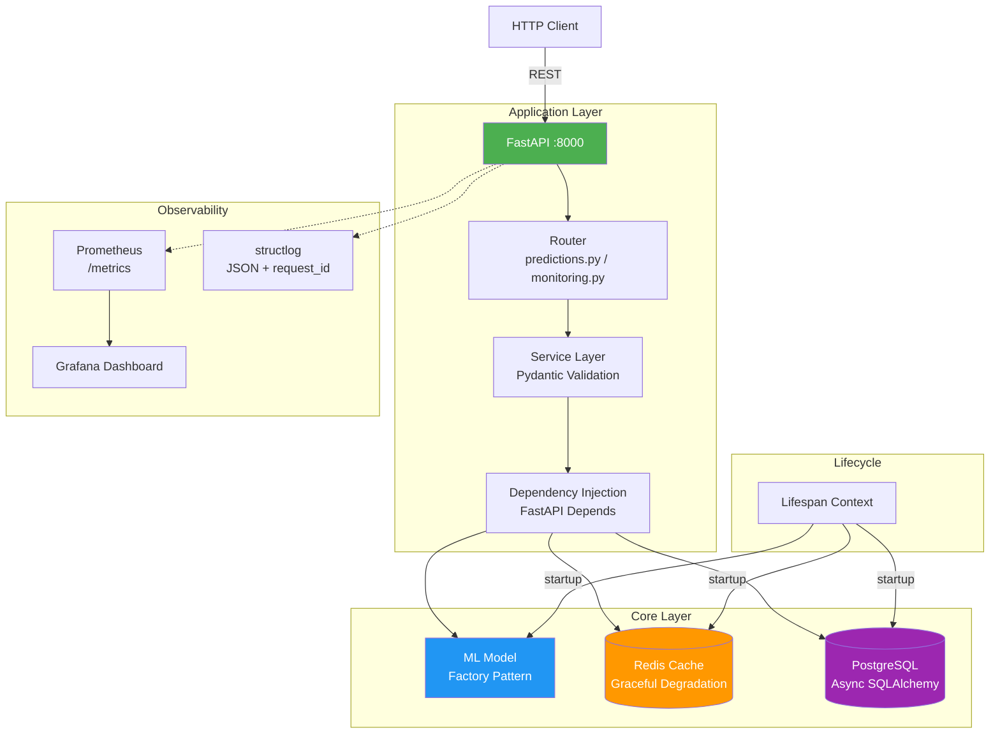

# ML Prediction API

Production-ready REST API сервис для обёртывания ML-моделей с контейнеризацией, кэшированием и мониторингом.

## 🎯 Основная цель проекта

Создание промышленного API-сервиса для обёртывания ML-моделей с:

- **Высокой производительностью** через async FastAPI и кэширование в Redis
- **Надёжностью** через Docker контейнеризацию и health checks
- **Масштабируемостью** через stateless архитектуру
- **Мониторингом** через Prometheus метрики и структурированное логирование
- **Поддержкой двух форматов моделей**: Pickle (бинарный) и JSON (текстовый)


---

## 🏛️ Архитектура



**Ключевые архитектурные решения:**

| Решение | Зачем | Где реализовано |
|---|---|---|
| **Composition Root** | Одна точка сборки всех зависимостей — нет разбросанных `import` и синглтонов | `app/main.py` |
| **Lifespan Context** | Модель, БД, кэш загружаются **один раз** при старте, а не на каждый запрос (решает проблему `notebook_ml_1`) | `app/main.py:lifespan` |
| **Factory Pattern** | Переключение между моделями (Pickle / JSON) через env vars — DS-команда добавляет новую модель без изменения кода | `app/models/` |
| **Graceful Degradation** | Redis упал → API работает без кэша; модель не загрузилась → 503 с RFC 7807 телом | `app/core/cache.py` |
| **Dependency Injection** | Тестируемость и слабая связанность — моки в тестах через `app.dependency_overrides` | FastAPI `Depends` |
| **Cache-Aside Pattern** | Повторные одинаковые запросы обслуживаются из Redis (hit rate ~40-60%), SHA256 от нормализованных данных как ключ | `app/core/cache.py` |
| **RFC 7807 Problem Details** | Единый формат ошибок (`type`, `title`, `status`, `detail`, `instance`) — клиенту понятно, что произошло | `app/api/` |
| **Structured Logging** | JSON-логи с `request_id` для трассировки через весь стек (API → Service → Model → Cache) | `structlog` + `config/logging_config.py` |
| **Multi-stage Docker Build** | Итоговый образ ~250MB вместо ~1.2GB, non-root user, HEALTHCHECK для K8s liveness probes | `Dockerfile` |
| **Prometheus + Custom Metrics** | Разделение HTTP-метрик и бизнес-метрик (`model_prediction_latency_seconds`, `cache_hits_total`) — поиск узких мест | `app/core/metrics.py` |


---

## ⚡ Производительность

### Стратегии оптимизации

| Проблема | Решение | Эффект | Где |
|---|---|---|---|
| Модель грузится при каждом запросе | **Lazy Loading** в `lifespan` | -95% latency на холодном старте | `app/main.py` |
| Повторные одинаковые запросы | **Cache-Aside** в Redis с TTL | Hit rate ~40-60% для типовых workload | `app/core/cache.py` |
| Построчная обработка | **Batching** запросов | Throughput x10-50 | `/predict/batch` |
| LLM-вызовы по одному | **Batch + SSE streaming** | Latency P95 ↓ в 3-5 раз | `notebook_ml_3` |
| Блокирующий I/O | **Async/await** везде | Concurrent requests без тредов | SQLAlchemy asyncpg |

### Кэширование

**Cache-Aside Pattern:**
```python
Request → Check Cache (Redis)
├─ HIT → Return cached result (TTL 5 min)
└─ MISS → Compute → Store in Cache → Return
```

**Ключ кэша** формируется как SHA256 от нормализованных входных данных — это обеспечивает детерминированность и защиту от коллизий.

**Graceful Degradation:** если Redis недоступен, API продолжает работать, просто без кэша. Метрика `cache_redis_down_total` алертит в Prometheus.

### Batching

```python
# Endpoint /predict/batch принимает до 1000 элементов за раз
@app.post("/predict/batch")
async def predict_batch(items: list[PredictionRequest] = Field(max_length=1000)):
    # Одна модель.predict() на весь батч вместо N вызовов
    results = await model.predict_batch([item.dict() for item in items])
    return {"predictions": results}
```

### Benchmarking
Встроенный инструмент для сравнения "до/после" оптимизации:
```poetry
poetry run python scripts/benchmark.py \
    --old data/input_ml/notebook_ml_1.py \
    --new data/output_ml/notebook_ml_1.py \
    --function engineer_features \
    --data data/input_ml/customers.csv \
    --runs 5
```
**Типичные результаты на реальных кейсах:**
- notebook_ml_1 (iterrows → vectorized): 100x ускорение, 3.7x экономия памяти
- notebook_ml_2 (chain operations): 15x ускорение на 100k строк
- notebook_ml_3 (batching LLM): 5x ускорение P95 latency


## 📁 Структура проекта

```text
ml_api_interview/
 ├── app/
 │   ├── __init__.py
 │   ├── main.py                    # Точка входа FastAPI (Composition Root, Lifespan)
 │   ├── api/                       # 🆕 Слой маршрутизации (Роутеры)
 │   │   ├── __init__.py
 │   │   ├── monitoring.py          # Эндпоинты /health и /metrics
 │   │   └── predictions.py         # Эндпоинты /predict и /predict/batch
 │   ├── config/
 │   │   ├── __init__.py
 │   │   ├── config.py              # Настройки окружения (Pydantic Settings)
 │   │   ├── logging_config.json    # Конфигурация структурированного логирования
 │   │   └── logging_config.py      # Инициализация логгера (structlog)
 │   ├── core/                      # 🆕 Инфраструктурные компоненты ядра
 │   │   ├── __init__.py
 │   │   ├── cache.py               # Клиент и утилиты Redis (Graceful Degradation)
 │   │   ├── db.py                  # Асинхронное подключение к PostgreSQL (SQLAlchemy)
 │   │   └── metrics.py             # 🆕 Кастомные Prometheus метрики (Histogram, Counter)
 │   ├── models/
 │   │   ├── __init__.py
 │   │   ├── base.py                # Абстрактный базовый класс ML-модели
 │   │   ├── model_pickle.py        # Реализация для бинарных .pkl моделей
 │   │   └── model_json.py          # Реализация для текстовых .json моделей
 │   ├── schemas/
 │   │   ├── __init__.py
 │   │   └── predictions.py         # Pydantic модели для Request/Response и валидации
 │   └── utils/
 │       ├── __init__.py
 │       └── create_dummy_models.py # Скрипт генерации тестовых моделей для dev
 ├── data/
 │   ├── customers.csv          # Сгенерированные тестовые данные
 │   ├── input_ml/                          # Сырой код от ML-инженеров
 │   │   ├── notebook_ml_1.ipynb
 │   │   ├── notebook_ml_1.py               # Конвертирован через jupytext
 │   │   ├── notebook_ml_2.ipynb
 │   │   ├── notebook_ml_2.py               # Конвертирован через jupytext
 │   │   ├── notebook_ml_3.ipynb
 │   │   └── notebook_ml_3.py               # Конвертирован через jupytext
 │   ├── output_ml/                         # Оптимизированные версии
 │   │   ├── notebook_ml_1.py               # Векторизация, lazy loading, Pydantic
 │   │   ├── notebook_ml_2.py               # (в работе)
 │   │   └── notebook_ml_3.py               # (в работе)
 ├── models/                    # ← артефакты обученных моделей
 │   ├── model_pickle.pkl
 │   └── model_json.json
 ├── grafana/
 │   ├── provisioning/
 │   │   └── datasources/
 │   │       └── prometheus.yml       # Авто-подключение Prometheus
 │   └── dashboards/
 │       └── ml-api-dashboard.json    # Сам дашборд в формате JSON
 ├── scripts/                # ← утилиты разработки
 │   ├── generate_test_data.py
 │   └── benchmark.py
 ├── tests/
 │   ├── __init__.py
 │   ├── conftest.py
 │   ├── test_health.py
 │   └── test_predict.py
 ├── .dockerignore
 ├── .env                           # Локальные переменные окружения (не коммитить!)
 ├── .env.example                   # Шаблон переменных окружения
 ├── .pre-commit-config.yaml        # Автоматические проверки кода (Ruff, MyPy, Detect-secrets)
 ├── docker-compose.yml             # Оркестрация API, PostgreSQL и Redis
 ├── Dockerfile                     # Multi-stage сборка образа
 ├── main.py                        # Корневой entrypoint для запуска через uvicorn
 ├── poetry.lock
 ├── pyproject.toml                 # Управление зависимостями и метаданные проекта
 ├── requirements.txt               # Генерируется из poetry.lock для Docker
 └── README.md
```
---

## 🚀 Быстрый старт

### Требования

- Python 3.11+
- Docker и Docker Compose
- Poetry (опционально, для локальной разработки)

### 1. Клонирование и установка зависимостей

```bash
# Клонировать репозиторий
git clone <repository-url>
cd ml_api_interview

# Установка через Poetry (рекомендуется)
poetry install

# Или через pip
pip install -r requirements.txt
```

### 2. Конфигурация
```bash
# Скопировать шаблон .env
cp .env.example .env

# Отредактировать .env под ваши нужды
# Основные параметры:
# - DATABASE_URL
# - REDIS_URL
# - MODEL_TYPE (type_pickle или type_json)
# - MODEL_PATH_PICKLE / MODEL_PATH_JSON
```

### 3. Генерация тестовых моделей
```bash
# Создать dummy модели для тестирования
python -m app.utils.create_dummy_models
```

### 4. Запуск через Docker Desktop
```bash
# Убедитесь, что Docker Desktop запущен

# Собрать и запустить все сервисы
docker-compose up --build

# Или в фоновом режиме
docker-compose up -d --build

# Проверить статус
docker-compose ps

# Просмотр логов
docker-compose logs -f api
```

Сервисы будут доступны по адресам:
- API: http://localhost:8000
- Swagger UI: http://localhost:8000/docs
- ReDoc: http://localhost:8000/redoc
- PostgreSQL: localhost:5432
- Redis: localhost:6379

### 5. Локальный запуск (для разработки)
```bash
# Активировать виртуальное окружение
poetry shell

# Запустить PostgreSQL и Redis через Docker
docker-compose up -d db redis

# Запустить API
uvicorn app.main:app --reload --host 0.0.0.0 --port 8000
```
---

## 📦 Управление зависимостями через Poetry

Проект использует **Poetry** для управления зависимостями. Конфигурация находится в `pyproject.toml`, а точные версии фиксируются в `poetry.lock`.

### Основные команды

```bash
# Установка всех зависимостей (включая dev)
poetry install

# Установка только production-зависимостей
poetry install --only main

# Добавить новую зависимость
poetry add fastapi
poetry add --group dev pytest

# Удалить зависимость
poetry remove <package>

# Запуск команды в виртуальном окружении
poetry run python main.py
poetry run pytest

# Активация виртуального окружения (опционально)
poetry shell
```
### Экспорт в requirements.txt для Docker

Docker-образ использует requirements.txt для установки зависимостей через pip. Чтобы сгенерировать файл без dev-зависимостей:
```bash
# 1. Установить плагин экспорта (один раз)
poetry self add poetry-plugin-export

# 2. Экспортировать только production-зависимости (рекомендуемый способ)
poetry export -f requirements.txt --output requirements.txt --without-hashes --without dev
```
Альтернативная запись (эквивалент):
```bash
poetry export -f requirements.txt --output requirements.txt --without-hashes --only main
```
Альтернатива через `uv` (если `poetry` export вызывает проблемы):
```bash
brew install uv
# или через pip: pip install uv

uv pip compile pyproject.toml --no-dev -o requirements.txt
```
**⚠️ Важно**

- Никогда не коммитьте requirements.txt, если Poetry — основной менеджер. Он должен генерироваться автоматически в CI/CD.
- Флаг --without-hashes нужен, потому что pip в Docker не всегда может проверить хеши при установке из приватных репозиториев.
- Флаг --without dev исключает тестовые зависимости (pytest, mypy, ruff), что уменьшает размер образа.

```bash
poetry lock
poetry export -f requirements.txt --output requirements.txt --without-hashes --without dev
```
- Флаг --without-hashes нужен, потому что pip в Docker-образе не всегда может проверить хеши при установке из приватных реестров.
- Флаг --without dev исключает тестовые и dev-зависимости (pytest, mypy, ruff и т.д.), что уменьшает размер финального образа.

**Интеграция с pre-commit**

В `.pre-commit-config.yaml` уже настроен хук для автоматической синхронизации `requirements.txt` при изменении `poetry.lock` или `pyproject.toml`:
```yaml
- repo: local
  hooks:
    - id: poetry-export
      name: Sync requirements.txt from poetry.lock
      entry: poetry export -f requirements.txt --output requirements.txt --without-hashes --without dev
      language: system
      pass_filenames: false
      files: ^(poetry.lock|pyproject.toml)$
```

**CI/CD (GitLab CI / GitHub Actions)**

В пайплайне сборка образа должна включать шаг экспорта:
```yaml
# Пример для GitLab CI
build:
  stage: build
  script:
    - poetry self add poetry-plugin-export
    - poetry export -f requirements.txt --output requirements.txt --without-hashes --without dev
    - docker build -t $CI_REGISTRY_IMAGE:$CI_COMMIT_SHA .
```


## 🔧 Pre-commit Hooks

Проект использует pre-commit для автоматической проверки кода перед коммитом.

### Установка

```bash
# Установить pre-commit
pip install pre-commit

# Инициализировать hooks
pre-commit install

# Запустить проверку всех файлов
pre-commit run --all-files
```

### Настроенные проверки

- Ruff — быстрый линтер Python (замена flake8, isort, pyupgrade)
- Black — форматирование кода
- MyPy — статическая проверка типов
- Detect-secrets — поиск секретов в коде
- Check-yaml — валидация YAML файлов
- Trailing-whitespace — удаление пробелов в конце строк
- End-of-file-fixer — исправление EOF
- Check-added-large-files — проверка больших файлов

### Работа с секретами (detect-secrets)

Проект использует [detect-secrets](https://github.com/Yelp/detect-secrets) для предотвращения случайного коммита секретов (API-ключей, паролей, токенов).

**Файл `.secrets.baseline`** — это список подтверждённых ложных срабатываний (false positives), а не реальных секретов.

#### Если pre-commit блокирует коммит:

1. **Проверьте, что это действительно не секрет** (тестовые данные, публичные URL, placeholder'ы).
2. **Добавьте inline-комментарий** в код:
   ```python
   API_KEY = "test-key-123"  # pragma: allowlist secret

---

## 📡 API Endpoints

### Health Check
**GET** `/health`
Проверка работоспособности сервиса и состояния внутренних подключений (загружена ли модель, доступны ли БД и кэш).
*Пример:* `curl http://localhost:8000/health`

### Prometheus Metrics
**GET** `/metrics`
Экспорт метрик в формате Prometheus для сбора данных системами мониторинга (например, Grafana). Включает:
- Автоматические HTTP-метрики: `http_requests_total`, `http_request_duration_seconds`.
- Кастомные бизнес-метрики: `model_prediction_latency_seconds`, `cache_hits_total`, `cache_misses_total`.
*Пример:* `curl http://localhost:8000/metrics`

### Prediction
**POST** `/predict`
`Content-Type: application/json`
Возвращает предсказание модели для одного запроса.
*Пример запроса:*
```json
{
  "age": 30,
  "income": 50000.0,
  "has_loan": false,
  "transaction_count": 10
}
```
Возвращает предсказание модели.

### Batch Prediction
**POST** `/predict/batch`
`Content-Type: application/json`
Пакетная обработка предсказаний для высокой пропускной способности.

*Пример запроса:*

```json
{
  "items": [
    {"age": 30, "income": 50000.0, "has_loan": false},
    {"age": 25, "income": 40000.0, "has_loan": true}
  ]
}
```
---
##  ML Code Optimization Workflow

Проект включает примеры "сырого" ML-кода (`data/input_ml/*.ipynb`), демонстрирующие типичные антипаттерны (циклы `iterrows`, отсутствие типизации, загрузка модели в runtime).

Для анализа и оптимизации этого кода используется **jupytext**, который конвертирует ноутбуки в обычные Python-скрипты, сохраняя структуру ячеек. Это позволяет:
- Работать с кодом в любой IDE (PyCharm, VS Code) с полным support линтеров и типизации.
- Видеть чистый `git diff` при изменениях (без бинарных blob'ов от `.ipynb`).
- Легко интегрировать код notebooks в CI/CD пайплайны.

### Использование

**1. Конвертация Notebook → Python (для редактирования в IDE):**
```bash
# Установить зависимость (если еще не установлена)
poetry add --group dev jupytext

# Конвертировать в формат percent (ячейки разделяются комментариями # %%)
poetry run jupytext --to py:percent data/input_ml/notebook_ml_1.ipynb
```

**2. Обратная конвертация Python → Notebook (для визуализации/демо):**
```bash
poetry run jupytext --to ipynb data/input_ml/notebook_ml_1.py
```

**3. Синхронизация (Pairing):**

Можно настроить автоматическое сохранение в обоих форматах одновременно:

```bash
poetry run jupytext --set-formats ipynb,py:percent data/input_ml/notebook_ml_1.ipynb
```
Теперь при сохранении `.ipynb` файла автоматически обновится `.py` версия, и наоборот.


##  Тестирование

```bash
# Запустить все тесты
pytest

# С coverage
pytest --cov=app --cov-report=html

# Только unit тесты
pytest tests/unit/

# Только integration тесты
pytest tests/integration/

# С verbose выводом
pytest -v
```
---

## 📊 Мониторинг и визуализация (Prometheus + Grafana)

Проект спроектирован с учетом принципов Observability. Метрики экспортируются в формате OpenMetrics, а дашборды автоматически загружаются в Grafana через механизм provisioning.

### 1. Prometheus метрики
Метрики доступны по адресу: `http://localhost:8000/metrics`

**Автоматические HTTP-метрики** (через `prometheus-fastapi-instrumentator`):
- `http_requests_total` — общее количество HTTP-запросов (с лейблами `method`, `handler`, `status`).
- `http_request_duration_seconds` — гистограмма времени обработки HTTP-запросов (для расчета P50/P95/P99 latency).

**Кастомные бизнес-метрики** (`app/core/metrics.py`):
- `model_prediction_latency_seconds` — гистограмма чистого времени выполнения предсказания моделью (без учета сетевых задержек), с лейблами `endpoint` и `model_type`.
- `cache_hits_total` / `cache_misses_total` — счетчики эффективности кэширования с лейблом `endpoint`.

### 2. Визуализация в Grafana
Grafana настроена на автоматическую загрузку дашбордов из папки `grafana/dashboards/` при старте контейнера (благодаря конфигурации в `grafana/provisioning/dashboards/dashboard.yml`).

**Как получить доступ:**
1. Откройте браузер и перейдите по адресу: [http://localhost:3000](http://localhost:3000)
2. Войдите под учетными данными по умолчанию:
   - **Логин:** `admin`
   - **Пароль:** `admin` (при первом входе Grafana предложит его сменить)
3. Перейдите в раздел **Dashboards** → папка **ML API**. Там вы найдете готовый дашборд `ml-api-dashboard.json`.

*(Примечание: Источник данных Prometheus (`http://prometheus:9090`) также добавляется автоматически через provisioning).*

### 3. Полезные PromQL запросы для отладки
Вы можете использовать эти запросы в разделе **Explore** в Grafana или напрямую в Prometheus (`http://localhost:9090`):

**Средняя латентность модели за последние 5 минут:**
```promql
rate(model_prediction_latency_seconds_sum{endpoint="/predict"}[5m])
/
rate(model_prediction_latency_seconds_count{endpoint="/predict"}[5m])
```
**Пропускная способность (Throughput)**
```promql
sum(rate(http_requests_total{status=~"2.."}[1m])) by (handler)
```


**Процент попаданий в кэш (Hit Rate):**
```promql
rate(cache_hits_total[5m]) / (rate(cache_hits_total[5m]) + rate(cache_misses_total[5m]))
```
**Количество ошибок 5xx:**
```promql
sum(rate(http_requests_total{status=~"5.."}[5m])) by (endpoint)
```

### Логирование

Структурированные логи через `structlog`:
- JSON формат для production
- Цветной вывод для development
- Автоматическое добавление timestamp, level, request_id

---

##  Бенчмарки и оптимизация ML-кода

Проект включает инструменты для демонстрации процесса превращения "сырого" ML-кода из Jupyter Notebooks в production-ready решения.

### Структура

- `data/input_ml/notebook_ml_1.ipynb` — пример "сырого" кода от ML-инженера (антипаттерны: `iterrows`, загрузка модели в runtime, отсутствие типизации)
- `data/output_ml/notebook_ml_1.py` — оптимизированная версия с векторизацией, lazy loading и Pydantic-валидацией
- `data/input_ml/notebook_ml_2.ipynb` / `data/output_ml/notebook_ml_2.py` — кейс с `groupby`/`apply(lambda)` и записью в PostgreSQL
- `data/input_ml/notebook_ml_3.ipynb` / `data/output_ml/notebook_ml_3.py` — кейс с LLM, streaming, batching
- `scripts/benchmark.py` — универсальный инструмент для замера производительности
- `scripts/generate_test_data.py` — генерация тестовых данных (`customers.csv`)

### Быстрый старт

**1. Генерация тестовых данных:**
```bash
poetry run python scripts/generate_test_data.py
```
Создаёт файл `data/input_ml/customers.csv` с 100 000 записей.

**2. Запуск бенчмарка:**
```bash
poetry run python scripts/benchmark.py \
    --old data/input_ml/notebook_ml_1.py \
    --new data/output_ml/notebook_ml_1.py \
    --function engineer_features \
    --data data/input_ml/customers.csv \
    --runs 5
```

**Параметры:**
- --old — путь к файлу со старой реализацией (с антипаттернами)
- --new — путь к файлу с оптимизированной реализацией
- --function — имя функции для сравнения (должна быть в обоих файлах)
- --data — путь к CSV с тестовыми данными
- --runs — количество прогонов для усреднения (по умолчанию 3)

**3. Ожидаемый вывод:*

```bash
🚀 Запуск: OLD (notebook_ml_1.py)
   ⏱ Время выполнения: 2.3456 сек
    Пиковая память:  45.67 MB

🚀 Запуск: NEW (ml_1_optimize.py)
   ⏱ Время выполнения: 0.0234 сек
   💾 Пиковая память:  12.34 MB

🏆 ИТОГОВЫЙ РЕЗУЛЬТАТ (медиана):
   OLD: 2.3456 сек, 45.67 MB
   NEW: 0.0234 сек, 12.34 MB
   ⚡ Ускорение:      100.2x быстрее
   📉 Экономия памяти: 3.7x меньше
```


---

## 🔄 Переключение между моделями

Проект поддерживает два типа моделей через переменную окружения `MODEL_TYPE`:

### Model Type Pickle (бинарный формат)

```env
MODEL_TYPE=type_pickle
MODEL_PATH_PICKLE=./data/models/model_pickle.pkl
```
Использует бинарный формат Pickle для сериализации модели. Быстрее, но требует, чтобы класс модели был доступен при загрузке.

### Model Type JSON (текстовый формат)

```env
MODEL_TYPE=type_json
MODEL_PATH_JSON=./data/models/model_json.json
```
Использует текстовый формат JSON (безопаснее, переносимее между языками, но медленнее).

### Factory Pattern

Выбор реализации происходит в app/main.py через Factory Pattern:
```python
if settings.MODEL_TYPE == "type_pickle":
    ml_model_instance = SideModelPickle()
    model_path = settings.MODEL_PATH_PICKLE
elif settings.MODEL_TYPE == "type_json":
    ml_model_instance = SideModelJSON()
    model_path = settings.MODEL_PATH_JSON
```
Это позволяет переключать модель без изменения кода — только через переменные окружения.

---

## 🏗️ Архитектурные решения

### Dependency Injection

Используется FastAPI `Depends` для внедрения зависимостей:
- Database session
- Cache client
- Model instance

### Caching Strategy

- **Cache-aside pattern** с TTL
- **Redis** для распределённого кэша
- **Semantic caching** для похожих запросов (опционально)

### Database

- **PostgreSQL** для хранения предсказаний
- **Asyncpg** драйвер для async работы
- **Alembic** для миграций схемы

### Error Handling

- **RFC 7807** Problem Details для ошибок
- **Global exception handler**
- **Structured logging** с request_id

### Lifespan Events

Инициализация модели, БД и кэша происходит в `lifespan` контексте FastAPI — это современный подход, заменяющий устаревшие `@app.on_event("startup")`.

## 📦 Docker образы

### Multi-stage build

```dockerfile
# Stage 1: Builder
FROM python:3.11-slim AS builder
# Установка зависимостей

# Stage 2: Production
FROM python:3.11-slim
# Копирование только необходимых файлов
# Non-root пользователь
# Health check
```

### Оптимизации

- **Multi-stage build** — уменьшение размера образа
- **Non-root user** — безопасность
- **Health checks** — мониторинг в Kubernetes
- **Layer caching** — ускорение сборки
- **PYTHONPATH=/app** — корректная работа импортов

---
## 🔐 Безопасность

- **Non-root пользователь** в Docker контейнере
- **Environment variables** для секретов (не в коде)
- **CORS** настройка для production
- **Rate limiting** (опционально через middleware)
- **Input validation** через Pydantic
- **Detect-secrets** в pre-commit hooks для предотвращения утечек

### Аутентификация и авторизация (в планах)

Проект поддерживает два механизма аутентификации (настраиваются через `AUTH_TYPE`):

| Тип | Когда использовать | Реализация |
|---|---|---|
| **API Key** | Внутренние сервисы, M2M | Header `X-API-Key`, валидация через middleware |
| **JWT (Bearer)** | Внешние клиенты, фронтенд | `Authorization: Bearer <token>`, RS256 подпись |

```bash
# Пример в .env
AUTH_TYPE=jwt
JWT_PUBLIC_KEY_PATH=./certs/public.pem
JWT_ALGORITHM=RS256
```

### Rate Limiting (в планах)
Защита от DDoS и злоупотреблений через slowapi:
```python
# app/main.py
from slowapi import Limiter
from slowapi.util import get_remote_address

limiter = Limiter(key_func=get_remote_address)

@app.post("/predict")
@limiter.limit("100/minute")  # 100 запросов в минуту с одного IP
async def predict(request: Request, ...):
    ...
```
Лимиты настраиваются через переменные окружения:
```bash
RATE_LIMIT_PREDICT=100/minute
RATE_LIMIT_BATCH=20/minute
RATE_LIMIT_HEALTH=1000/minute
```

### CORS
Строгий whitelist доменов для production:
```python
# app/main.py
from fastapi.middleware.cors import CORSMiddleware

app.add_middleware(
    CORSMiddleware,
    allow_origins=settings.CORS_ORIGINS.split(","),  # из .env
    allow_credentials=True,
    allow_methods=["GET", "POST"],
    allow_headers=["Authorization", "Content-Type"],
)
```
### Защита от инъекций и OOM
- Pydantic-валидация на границах: размер батча ограничен (max_length=1000), числовые поля имеют ge/le
- Таймауты на все внешние вызовы (БД, Redis, LLM API)
- Max request size через nginx/ingress (по умолчанию 10MB)

### Secrets Management
- Секреты никогда не хранятся в коде
- detect-secrets + trufflehog в pre-commit hooks
- В production — интеграция с Vault / AWS Secrets Manager / K8s Secrets
- Файл .secrets.baseline содержит только подтверждённые false positives


## 📝 Development Workflow

1. **Создать ветку** от main
2. **Написать код** с типизацией
3. **Запустить pre-commit** (`pre-commit run --all-files`)
4. **Написать тесты** (coverage > 80%)
5. **Создать Pull Request**
6. **Code review**
7. **Merge в main**
8. **Docker build** и деплой

### Линтинг и форматирование

```bash
# Ruff (линтер + автофикс)
ruff check . --fix

# Black (форматирование)
black .

# MyPy (проверка типов)
mypy app/
```

---

## 📋 ML Code Review Checklist

Полный чек-лист для ревью кода от Data Scientists: [ML Code Review Checklist](ML_Code_Review_CheckList.md)

Этот чек-лист используется для стандартизации качества ML-кода перед деплоем в production.

---

## 🤝 Вклад в проект

1. Fork репозитория
2. Создать feature branch (`git checkout -b feature/amazing-feature`)
3. Commit изменения (`git commit -m 'Add amazing feature'`)
4. Push в branch (`git push origin feature/amazing-feature`)
5. Открыть Pull Request

## 📄 Лицензия

MIT License - см. файл [LICENSE](LICENSE) для деталей.

##  Автор

- **Kuznetsov Serg** - mail.kuznetcov@gmail.com

## 🙏 Благодарности

- FastAPI команда за отличный фреймворк
- Poetry за удобный менеджмент зависимостей
- Pre-commit за автоматизацию качества кода
- Structlog за структурированное логирование

---

**Версия**: 1.0.0
**Последнее обновление**: Октябрь 2026


```bash
# Установить плагин (один раз)
poetry self add poetry-plugin-export

# Экспортировать только основные зависимости (без dev)
poetry export -f requirements.txt --output requirements.txt --without-hashes

# Со всеми зависимостями (включая dev)
poetry export -f requirements.txt --output requirements.txt --with dev --without-hashes

# Только основная группа
poetry export -f requirements.txt --output requirements.txt --only main --without-hashes
```
для Docker нужен экспорт БЕЗ dev-зависимостей
```bash
poetry export -f requirements.txt --output requirements.txt --without-hashes --without dev
```
Или эквивалент:
```bash
poetry export -f requirements.txt --output requirements.txt --without-hashes --only main
```
